<div align="center">

<picture>
  <source media="(prefers-color-scheme: dark)" srcset="docs/hero-dark.svg">
  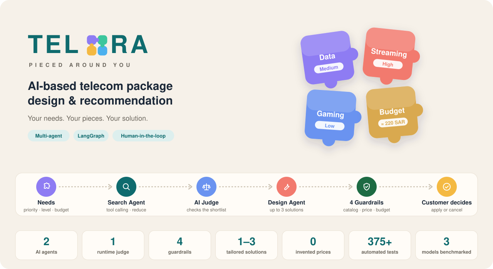
</picture>

<br><br>

<sub><b>AI & AGENTS</b></sub><br>


<sub><b>TECHNIQUES</b></sub><br>


<sub><b>BACK-END</b></sub><br>


<sub><b>DATA</b></sub><br>


<sub><b>FRONT-END</b></sub><br>


<sub><b>TESTING & DOCS</b></sub><br>


[Highlights](#technical-highlights) · [Architecture](#architecture) · [Agents in depth](#agents-in-depth) · [Lifecycle](#request-lifecycle--persistence) · [Evaluation](#observability--evaluation) · [Screenshots](#screenshots) · [Getting started](#getting-started)

<br>

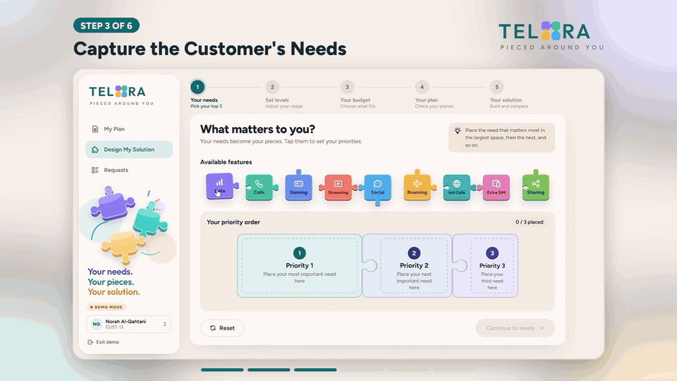

<sub>A customer builds a plan: needs → agents at work → tailored solutions → apply.</sub>

</div>

TELORA designs personalized telecom plans with a multi-agent LLM workflow. A customer states their needs, usage levels, and budget. A **Search Agent** and a **Solution Design Agent** then build up to three solutions from the provider's existing catalog. Every price is computed by code, every pick is grounded in the catalog, and nothing changes until the customer approves.

> [!NOTE]
> Capstone project. All customers, packages, and prices are **synthetic**, and plan activation is **simulated**.

## Technical highlights

1. **IDs-only LLM outputs.** Models return catalog IDs and short rationales, never prices or product facts. Python resolves every ID against the catalog, and an unknown ID is treated as invalid structured output.
2. **Validated native tool calling.** The Search Agent decides which tools to call, but each call is checked before it runs: no invented or re-levelled needs, an unchanged budget, each tool at most once, and at most 6 rounds.
3. **Deterministic Pareto reduction.** Before any LLM ranking, candidates that are worse on every need-relevant capability and not cheaper are removed.
4. **Runtime LLM Judge.** A separate, stronger model (`gpt-5.6-terra`) reviews the shortlist for coverage, usage fit, priority order, budget relevance, and redundancy. It can trigger exactly one gap-targeted re-assessment.
5. **Policy-isolated design.** Strategies come from a fixed policy library. Each design prompt sees only its own policy, plus the compositions earlier strategies already chose.
6. **Deterministic pricing tool.** `calculate_solution` uses `Decimal` arithmetic. The customer's budget is bound inside the tool, so the model cannot set or override it.
7. **Guardrails before recommendation.** Four deterministic checks run before comparison and recommendation, so an invalid solution can never be recommended or shown.
8. **Strict contracts end to end.** Pydantic models reject unknown fields, lifecycle transitions are compare-and-set in SQLite transactions, and database triggers keep order history immutable.

## Architecture

### High-level view

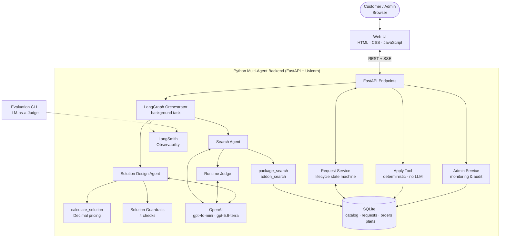

- **SQLite is the single source of truth.** The LangGraph state carries only the `request_id`. Each node persists its outcome through the Request Service, and routing re-reads the saved state.
- **The graph ends at customer selection.** Applying a solution is a separate, deterministic step triggered by the customer.

### Inside the agents

Border colors show who decides at each step: every LLM step is followed by a deterministic check.

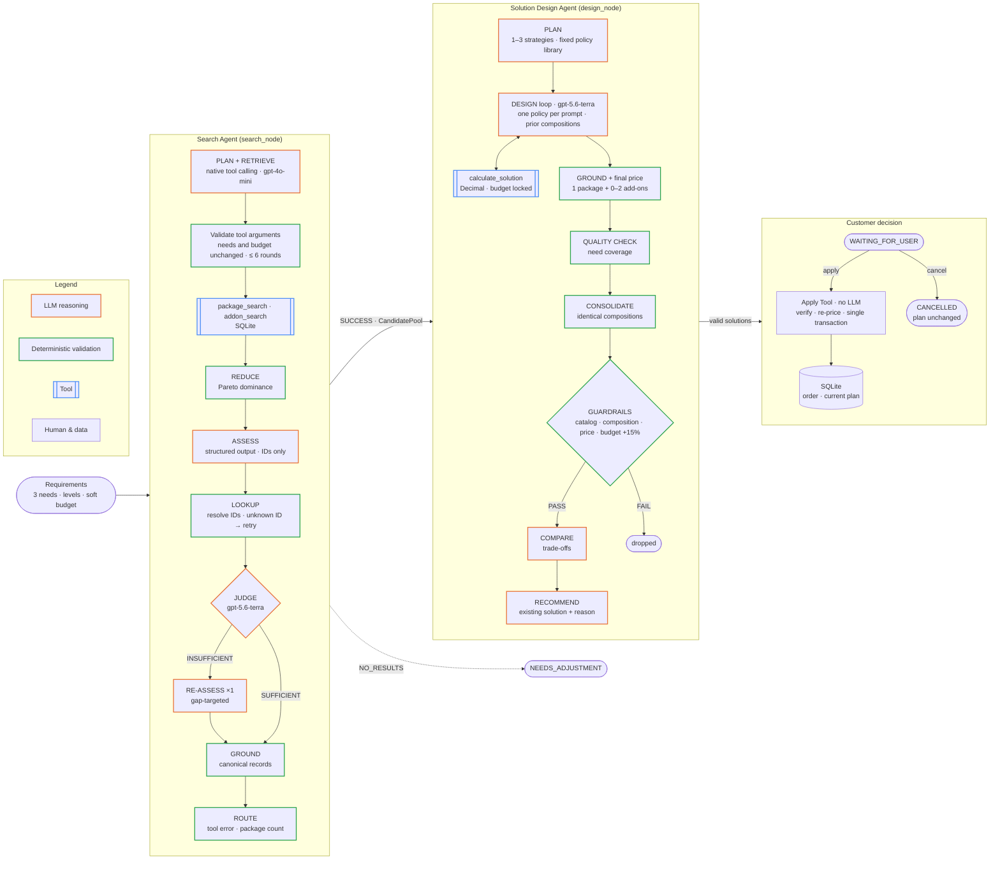

## Agents in depth

### Search Agent

| Stage | What happens | Type |
|---|---|---|
| **Plan + Retrieve** | The model is bound to `package_search` and `addon_search` and decides which to call, with which original needs. Results return as `ToolMessage`s in the same conversation. | LLM tool calling |
| **Validate** | Each call is checked against the original requirements before execution: known need names, levels, and priorities only, the original budget, and each tool at most once. | Deterministic |
| **Reduce** | Removes candidates that are worse on every need-relevant field and not cheaper. Exact ties are kept. | Deterministic |
| **Assess** | Shortlists the smallest set of strong, distinct candidates. Returns ordered IDs, a status, and notes only. | LLM |
| **Lookup** | Rebuilds records from tool outputs in the chosen order, and rejects duplicate or unknown IDs. | Deterministic |
| **Judge** | Returns `SUFFICIENT`, or `INSUFFICIENT` with typed gaps (`WEAK_COVERAGE`, `LIMITED_OPTIONS`, `EXCESSIVE_REDUNDANCY`). | LLM (`gpt-5.6-terra`) |
| **Re-assess ×1** | Reconsiders the full retrieved pool against the Judge's gaps. No second retrieval and no second Judge. | LLM |
| **Ground** | Replaces every selected candidate with its canonical catalog record. | Deterministic |
| **Route** | Decided from observable facts only (a tool error, or the grounded package count), never from the model's own status. | Deterministic |

### Solution Design Agent

| Stage | What happens | Type |
|---|---|---|
| **Plan** | Selects policies from a fixed library: `REQUIREMENT_FIT` (always, exactly once), plus `CORE_FOCUS` and `CAPABILITY_HEADROOM` only when the pool shows a real trade-off. This yields 1–3 strategies. | LLM |
| **Design loop** | One tool-calling conversation per strategy. The model may price compositions with `calculate_solution` zero or more times (≤ 6 rounds), then submits a `DesignProposal`. | LLM tool calling |
| **Ground + final price** | Resolves the proposal (1 package + 0–2 distinct add-ons) and runs the authoritative calculation. | Deterministic |
| **Quality check** | Reviews which requested needs each component covers, using the same capability rules as Search. | Deterministic |
| **Consolidate** | Merges strategies that converged on an identical composition, and records which strategies converged. | Deterministic |
| **Guardrails** | Catalog validity, composition validity, price integrity, and a budget hard limit (+15%). Failing solutions are dropped. | Deterministic |
| **Compare** | Describes trade-offs between valid solutions. A single solution gets a deterministic comparison with no LLM call. | LLM |
| **Recommend** | Picks one existing valid solution and explains why. It cannot introduce new components or prices. | LLM |

### Prompt and tool design

- **Supplied text is data, not instructions.** Prompts tell the model to treat requirements and catalog text as data, and no hidden chain-of-thought is requested or stored.
- **One policy lens per prompt.** The design prompt is assembled from a shared guidance block plus only the selected policy's doctrine. PLAN's free-text intent is not passed to DESIGN, so it cannot dilute the policy.
- **Diversity without forcing it.** Each strategy sees the compositions already chosen, and is asked to explore a different one only when it serves its policy equally well.
- **Budget locked in the tool.** The pricing tool's schema accepts only `package_id` and `addon_ids`, and the budget is captured in a closure.
- **Tool errors are observations.** An invalid ID returns `{"error": ...}` to the model instead of crashing the run, so the agent can correct itself.
- **Python owns the facts.** Budget fit, totals, and need coverage are set by code, and the LLM's free text cannot override them.

## Request lifecycle & persistence

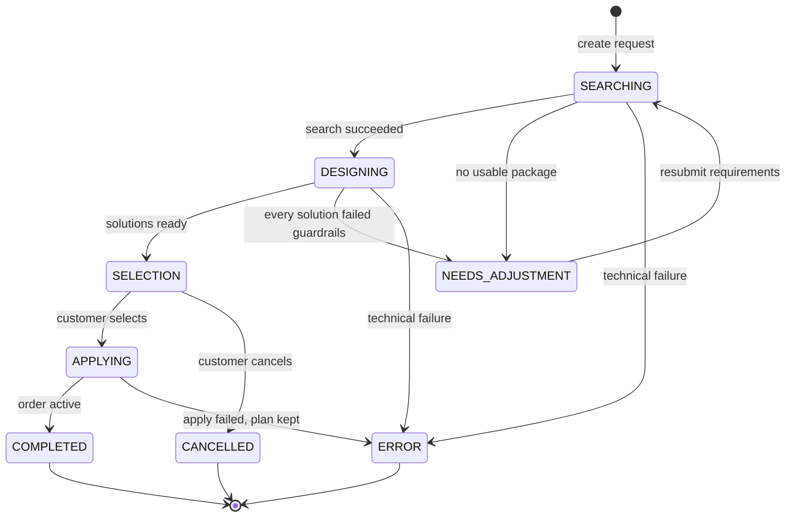

- **Compare-and-set transitions.** Every lifecycle event declares its allowed source state, so a repeated or out-of-order event is rejected instead of silently overwriting state.
- **Atomic writes.** State changes and their outputs are committed together in SQLite transactions (`BEGIN IMMEDIATE`), for example the solutions and `WAITING_FOR_USER` in one write.
- **Immutable history.** Database triggers protect an order's identity, composition, price, plan snapshots, and creation time, and block order deletion.
- **Versioned migrations.** The schema is migrated transactionally (currently version 16), and existing requests and orders are preserved.
- **Interrupted-run recovery.** Each web boot has an executor ID. At startup, builds owned by an earlier boot are marked as interrupted, while waiting and terminal requests are left untouched.
- **Live progress.** The UI subscribes to Server-Sent Events that report each stage (`understanding`, `finding`, `checking`, `building`, `done`) and the final solutions.

## Reliability & failure handling

- **Bounded technical retry.** Every LLM operation gets at most one immediate retry, and SDK-level retries are disabled so the bound holds. Retries apply only to:

  | Category | Examples |
  |---|---|
  | `INVALID_SCHEMA` | Pydantic or output-parsing errors, invalid requirement references, unknown IDs |
  | `TIMEOUT` / `CONNECTION` | OpenAI timeouts and network errors |
  | `TEMPORARY_RATE_LIMIT` | 429s with an explicit transient rate-limit code |
  | `SERVER_ERROR` | HTTP 500, 502, 503, 504 |

  Quota, authentication, permission, and unknown 429 errors fail immediately.
- **Strategy isolation.** If one strategy fails its design or review, it is dropped and the others continue. The request fails only if every strategy fails.
- **Graceful degradation.** If comparison fails, solutions are still shown without a comparison. If recommendation fails, solutions are shown without a recommendation.
- **Two failure types.** Technical failures (infrastructure such as OpenAI connectivity) are recorded separately from agent quality issues (a result outside the catalog, or one that does not do its job), and the admin console reports them separately.

## Observability & evaluation

- **Tracing (LangSmith).** Each request has one root trace covering creation, Search, Solution Design, selection, and Apply. Every LLM attempt, tool call, retry decision, and error is recorded. Customer names and credentials are excluded from traces.
- **Runtime metrics.** Every live Search, Solution Design, and Apply run gets an `evaluation` child run with deterministic scores, such as candidate ID validity, grounding, needs coverage, budget compliance, canonical price, and rollback correctness.
- **Offline experiments (LLM-as-a-Judge).** Five datasets are generated from the catalog: `search_agent_eval`, `solution_design_eval`, `apply_tool_eval`, `workflow_eval`, and `end_to_end_eval`. Explicit rubrics in `backend/evaluation/rubrics.py` define 11 Search criteria, 8 Solution Design criteria, and 8 end-to-end criteria. Semantic graders return only 0, 0.5, or 1 with short evidence.
- **Model benchmarking.** The workflow was evaluated on **GPT-4o-mini, GPT-5.6-terra, and GPT-5.6-sol**.
- **Unit tests.** 375+ tests use mocked LLMs and isolated temporary databases, so they make no API calls.

```bash
python -m backend.evaluation.cli sync-datasets
python -m backend.evaluation.cli run --dataset end_to_end_eval             # deterministic metrics
python -m backend.evaluation.cli run --dataset end_to_end_eval --semantic  # adds LLM graders (model costs apply)
```

## Admin console

| Page | What the admin sees |
|---|---|
| **Overview** | Requests, plan changes, failures, where requests stop, revenue change, and recommendation acceptance |
| **Requests** | Each request's full journey: needs, search, design, guardrails, the customer's decision, and apply |
| **Customers** | Each customer's current plan and request history |
| **Agents** | For each agent: does it run without errors, does it stay inside the catalog, and does it do its job |
| **Catalog** | Every package and add-on, with how often it is shortlisted, recommended, applied, and active on customer plans |

## Screenshots

**Customer journey**

<table>
  <tr>
    <td width="33%">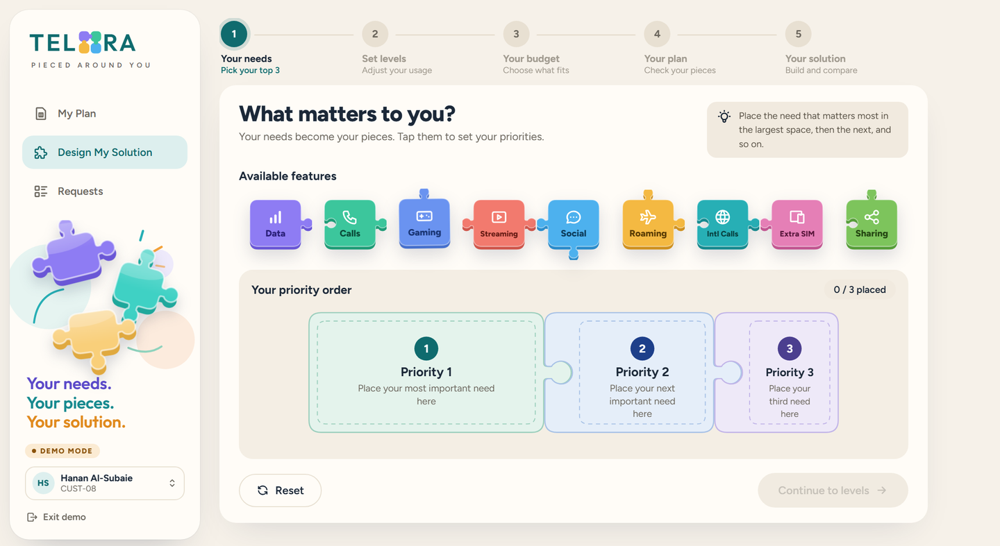</td>
    <td width="33%">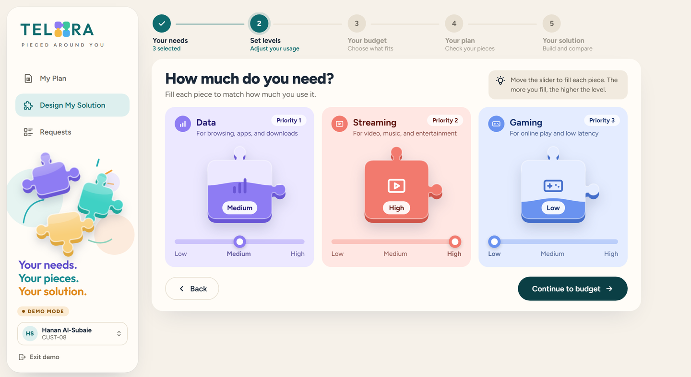</td>
    <td width="33%">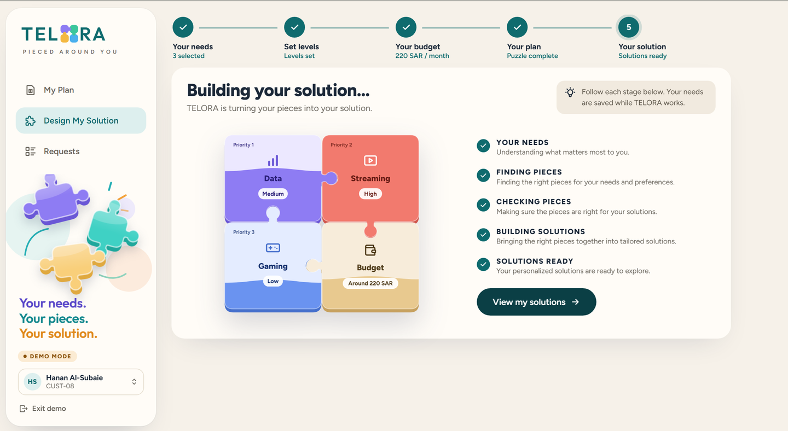</td>
  </tr>
  <tr>
    <td align="center"><b>1. Pick your top three needs</b></td>
    <td align="center"><b>2. Set how much you use each</b></td>
    <td align="center"><b>3. Agents at work, live</b></td>
  </tr>
  <tr>
    <td width="33%">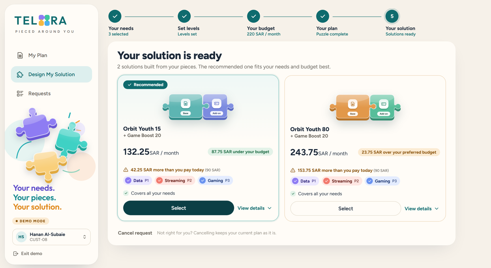</td>
    <td width="33%">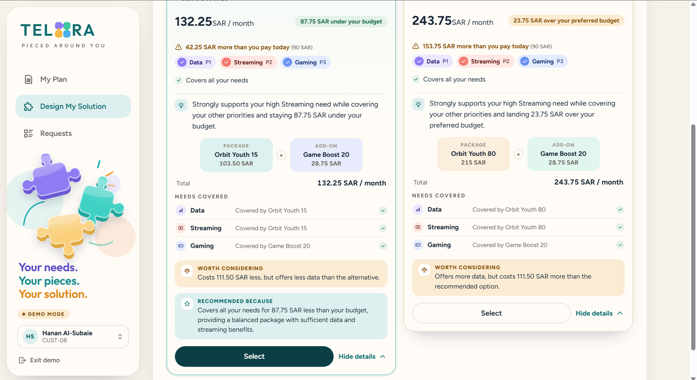</td>
    <td width="33%">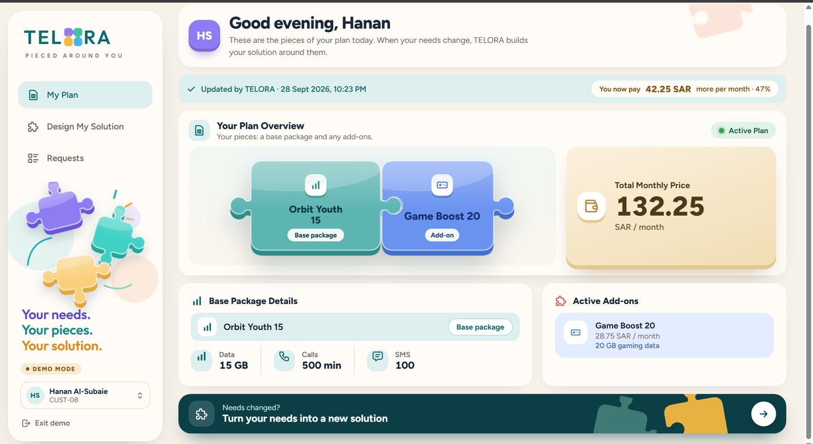</td>
  </tr>
  <tr>
    <td align="center"><b>4. Tailored solutions</b></td>
    <td align="center"><b>5. Explained trade-offs & reason</b></td>
    <td align="center"><b>6. New plan, applied</b></td>
  </tr>
</table>

**Admin console**

<table>
  <tr>
    <td width="33%">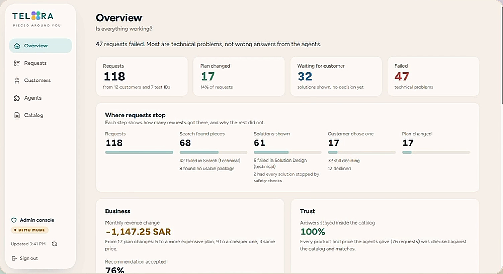</td>
    <td width="33%">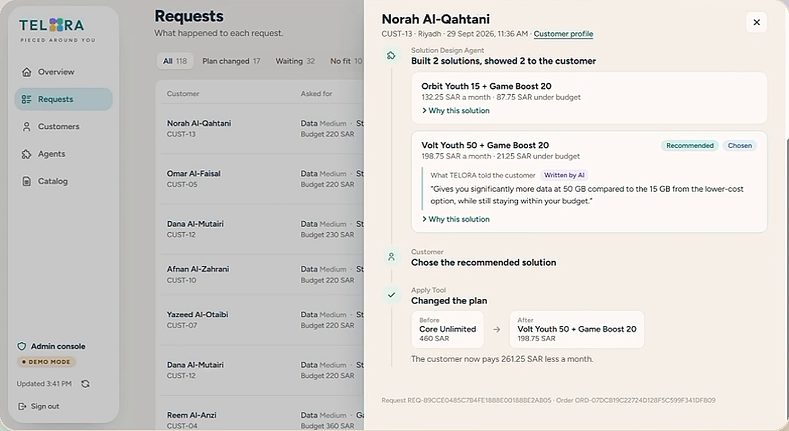</td>
    <td width="33%">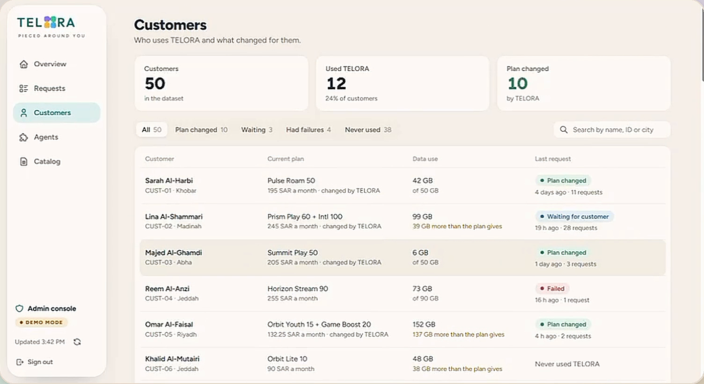</td>
  </tr>
  <tr>
    <td align="center"><b>Overview</b></td>
    <td align="center"><b>Request journey</b></td>
    <td align="center"><b>Customers & plans</b></td>
  </tr>
  <tr>
    <td width="33%">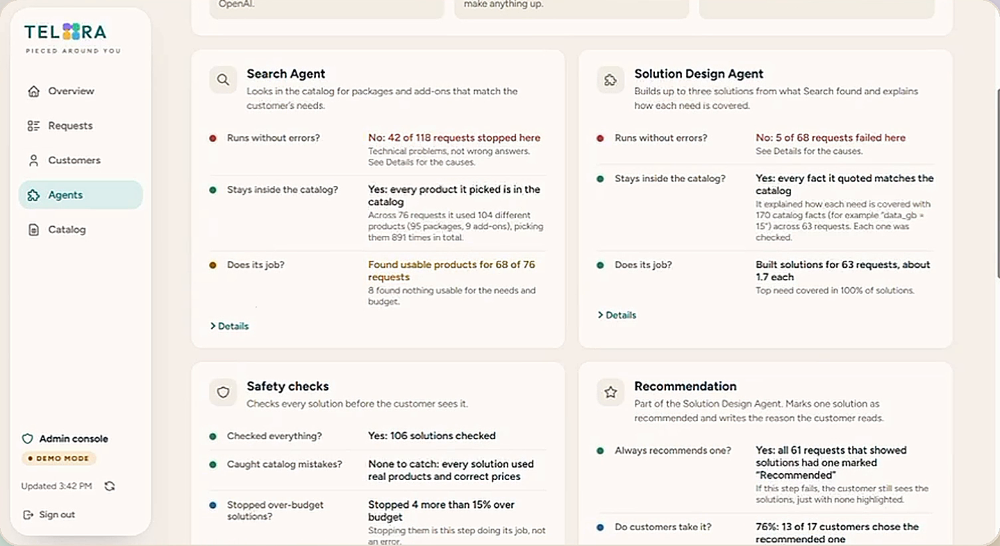</td>
    <td width="33%">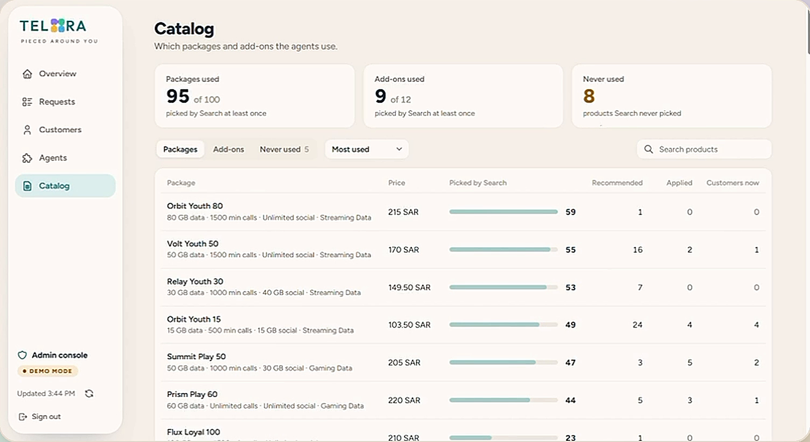</td>
    <td width="33%"></td>
  </tr>
  <tr>
    <td align="center"><b>Agent monitoring</b></td>
    <td align="center"><b>Catalog</b></td>
    <td></td>
  </tr>
</table>

## Tech stack

| Area | Tools |
|---|---|
| Agents & AI | LangGraph, LangChain (`langchain-core`, `langchain-openai`), OpenAI API: GPT-4o-mini and GPT-5.6-terra (GPT-5.6-sol in benchmarking) |
| Techniques | Multi-agent orchestration, native tool calling, structured outputs, LLM-as-a-Judge, deterministic guardrails, human-in-the-loop |
| Back-end | Python 3.11+, FastAPI, Uvicorn, Pydantic, Server-Sent Events, python-dotenv |
| Data | SQLite (transactions, triggers, migrations), openpyxl (Excel catalog import) |
| Front-end | HTML5, CSS3, JavaScript (no framework, `fetch` + `EventSource`), Google Fonts |
| Observability & evaluation | LangSmith (tracing, runtime metrics, datasets, experiments) |
| Testing & docs | unittest, pytest, Mermaid |

## Getting started

**Prerequisites:** Python 3.11 or newer, an OpenAI API key with access to the configured models, and (optionally) a LangSmith API key for tracing.

**1. Install**

```bash
git clone <repo-url> telora
cd telora

python -m venv .venv
# macOS / Linux
source .venv/bin/activate
# Windows
.venv\Scripts\activate

pip install -r requirements.txt
```

**2. Configure**

```bash
cp .env.example .env    # Windows: copy .env.example .env
# then edit .env and add your keys
```

**3. Run**

```bash
uvicorn backend.api.app:app --reload
```

Open <http://127.0.0.1:8000>, then choose **Customer** to build a solution or **Admin** to open the console.

<details>
<summary><b>More: database, terminal flow, and tests</b></summary>

<br>

**Database.** The repository includes a ready database (`data/telora.sqlite3`) with the synthetic catalog (100 packages, 12 add-ons) and 50 customers on their original plans. To start again from a clean state, delete that file and rebuild it from the Excel source:

```bash
python -m backend.database.seed_data
```

**Terminal flow.** A terminal version of the customer flow is also available:

```bash
python -m backend.main
```

**Tests.**

```bash
python -m unittest discover -s tests
# or with pytest (pip install pytest):
python -m pytest -q
```

</details>

## Project structure

<details>
<summary><b>Show folders</b></summary>

<br>

```text
telora/
├── backend/
│   ├── agents/          # Search Agent and Solution Design Agent
│   ├── api/             # FastAPI app: REST + SSE, serves the web UI
│   ├── database/        # SQLite access, migrations, Excel seeding
│   ├── evaluation/      # LangSmith datasets, rubrics, evaluators, CLI
│   ├── guardrails/      # Four deterministic solution guardrails
│   ├── schemas/         # Pydantic / dataclass contracts
│   ├── services/        # Request lifecycle, workflows, admin, history, tracing, retry
│   ├── tools/           # package_search, addon_search, calculate_solution, apply
│   ├── workflow/        # LangGraph graph, nodes, routing
│   └── main.py          # Terminal customer flow
├── frontend/web/        # Customer view and admin console (HTML/CSS/JS)
├── data/                # Synthetic catalog (Excel) and SQLite database
├── docs/                # Technical notes, screenshots, demo GIF, and hero images
├── tests/               # Unit tests (mocked LLMs, temp databases)
├── live_*_test.py       # Manual live tests against the real API
├── .env.example
├── LICENSE
└── requirements.txt
```

</details>

## API reference

<details>
<summary><b>Show endpoints</b></summary>

<br>

| Method | Endpoint | Purpose |
|---|---|---|
| GET | `/api/demo/customers` | List demo customers |
| POST | `/api/demo/session` | Start a demo session for a customer |
| POST | `/api/session/end` | End the session |
| GET | `/api/me`, `/api/me/plan`, `/api/me/requests` | Current customer, plan, and request history |
| POST | `/api/build` | Submit needs and budget, then start the workflow in the background |
| GET | `/api/build/{request_id}/events` | Stream live stage progress and final solutions (SSE) |
| POST | `/api/requests/{request_id}/apply` | Apply the selected solution |
| POST | `/api/requests/{request_id}/cancel` | Cancel the request and keep the current plan |
| GET | `/api/admin/overview`, `/requests`, `/requests/{id}`, `/customers`, `/customers/{id}`, `/agents`, `/catalog`, `/system` | Admin console data |
| GET | `/api/health` | Health check |

</details>

## Design decisions & limitations

- **LLM chooses, code calculates.** Models return IDs and short rationales, never prices or catalog facts.
- **Budget is a preference, not a wall.** Agents treat it as soft, and the guardrail sets a hard cap at +15%.
- **Fewer, honest options.** The number of solutions (one to three) follows the real trade-offs in the catalog, not a quota.
- **Synthetic data and simulated activation.** Plans are not activated with any real provider.
- **Single web worker.** Background workflows run in-process, so the app assumes one Uvicorn worker.

> [!WARNING]
> **Demo mode only.** The customer picker sets a demo cookie, and the admin console has no login. Neither is authentication, so both must be secured before any real deployment.

More detail on persistence, lifecycle states, retries, and trace structure: [`docs/TECHNICAL_NOTES.md`](docs/TECHNICAL_NOTES.md).

## Team

- **Farah Alhajjaji** · [LinkedIn](https://www.linkedin.com/in/farah-alhajjaji)
- **Layan Alharbi** · [LinkedIn](https://www.linkedin.com/in/layan-alharbi-b65a78363/)

## License

Released under the [MIT License](LICENSE).
